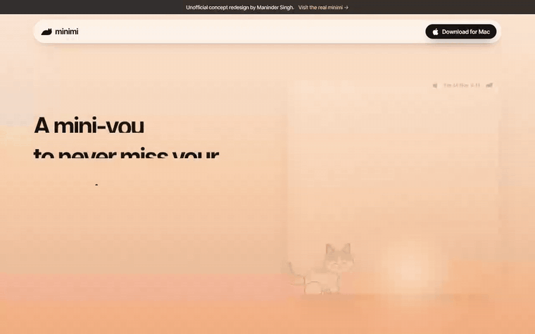
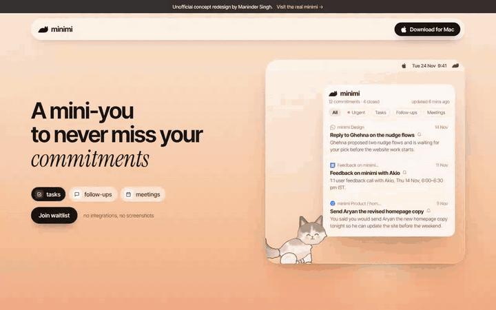
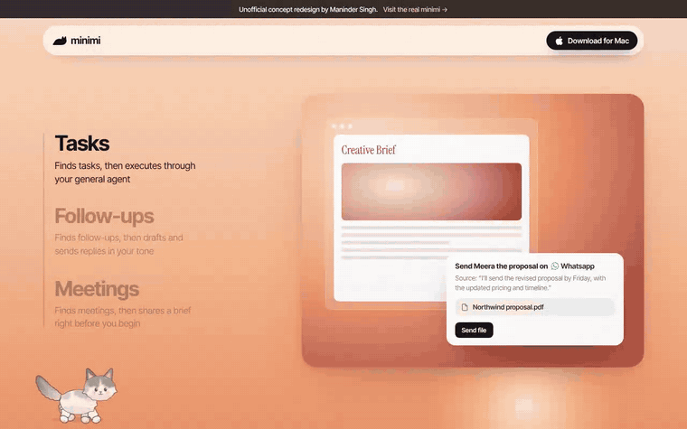
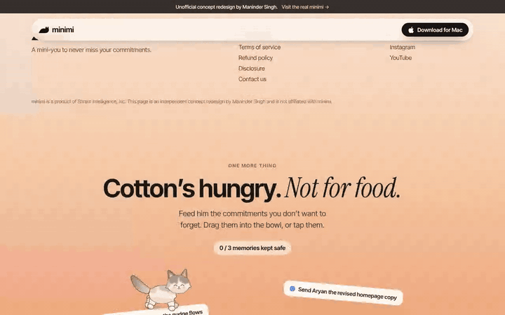
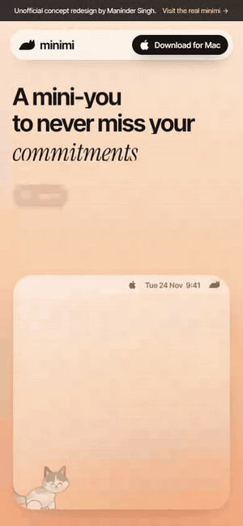
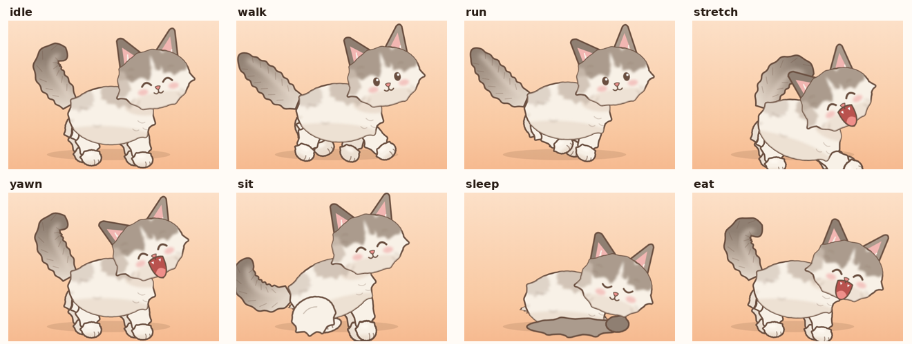

<div align="center">

# minimi, reimagined

**An unofficial concept redesign of [projectminimi.com](https://www.projectminimi.com/), built around Cotton, minimi's cat.**

Astro · GSAP ScrollTrigger · Lenis · hand-built SVG animation



</div>

> This is a personal concept project by Maninder Singh. It is not affiliated with minimi or Shram Intelligence, Inc. All product copy and examples come from minimi's own website, and every "Join waitlist" and "Download for Mac" link points to the real site. The page is marked `noindex` so it can never be mistaken for the original.

---

## The idea

minimi was built in memory of Cotton, the team's kitten, and Cotton became its mascot. This redesign makes him the guide through the whole page, and lets a full day pass while you read it. The sky moves from morning to golden hour, dusk, night and back to sunrise as you scroll.

## What's inside

### Cotton lives on the page

He runs along the bottom of the screen while you scroll, and the faster you scroll, the faster he runs. Scroll back up and he turns around. Stop, and he slows down, wanders, stretches, yawns, tilts his head, and eventually curls up for a nap. Tap him and he says hello.



### Tasks, follow-ups and meetings, told as a story

The section pins in place while you scroll through it. Each of minimi's three jobs plays out on a recreated product card: a file gets sent, an email reply types itself out, a meeting brief appears. Cotton hops every time one is done.



### The ending: feed Cotton

"Cotton's hungry. Not for food." Drag your commitments into his bowl (or tap them). He eats each one, then curls up asleep: *Fed on memories. Forgets nothing. That's minimi.*



### Built for every screen



Every effect has a touch version, and nothing important is hover-only.

| Screen | What changes |
| --- | --- |
| Desktop (1440 × 900 and up) | Full layout, pinned story section, magnetic buttons, Cotton follows your cursor |
| Short laptops (1366 × 768, 1280 × 720) | Pinned section and ending resize to fit the height |
| Tablets (768 × 1024, 1024 × 768) | Single column, story section cycles on its own |
| Phones (360 to 430 wide) | Native touch scrolling drives Cotton, tap to feed, stacked layout |
| Phones in landscape (844 × 390) | Compact headings and a side-by-side memory layout |

It was checked at each of these sizes for horizontal overflow, overlapping content and console errors. It also respects `prefers-reduced-motion`.

<br clear="right" />

## Meet Cotton



Cotton is not an image or a bought model. He is drawn in SVG from code and animated as a puppet:

- **Fur:** shapes are generated with soft, rounded tufts along the outline, and the markings are blurred into the cream fur so the edges look painted rather than cut out.
- **Tail:** a single plume built along a 16-point spine with a colour gradient. It bends, sways and streams back as he runs.
- **Movement:** a small state machine (idle, walk, run, sit, sleep, eat) blends every joint smoothly. Walking moves the legs in diagonal pairs and running in bounding pairs, and the speed comes straight from your scroll velocity.
- **Life when idle:** random blinks, ear flicks, head tilts, and the stretch-and-yawn pose from minimi's own illustration.

## Tech

| | |
| --- | --- |
| Framework | [Astro](https://astro.build), static output |
| Motion | [GSAP](https://gsap.com) with ScrollTrigger (pinning, scrubbing, sky timeline) |
| Smooth scroll | [Lenis](https://lenis.darkroom.engineering), driven from the GSAP ticker |
| Mascot | Hand-written SVG puppet (`src/scripts/cotton2d.js`), no images |
| Icons | [Simple Icons](https://simpleicons.org) (CC0) |
| Type | Inter Tight and Instrument Serif via Fontsource (OFL) |

```
src/
├── pages/index.astro        every section of the page
├── scripts/main.js          scroll, sky, Cotton's behaviour, story section, ending
├── scripts/cotton2d.js      Cotton: drawing and animation
├── styles/global.css        design tokens, layout, responsive rules
├── components/              cat mark and app icons
└── layouts/Base.astro       document head
```

## Run it locally

```bash
npm install
npm run dev
```

Open http://localhost:4321. Run `npm run build` for a static build in `dist/`.

Add `?motion=full` to the URL to see every animation even with reduced motion turned on.

## Credits

minimi, its copy, product examples and Cotton belong to Shram Intelligence, Inc. The testimonials are minimi's own embedded posts on X. Design and code by Maninder Singh.
